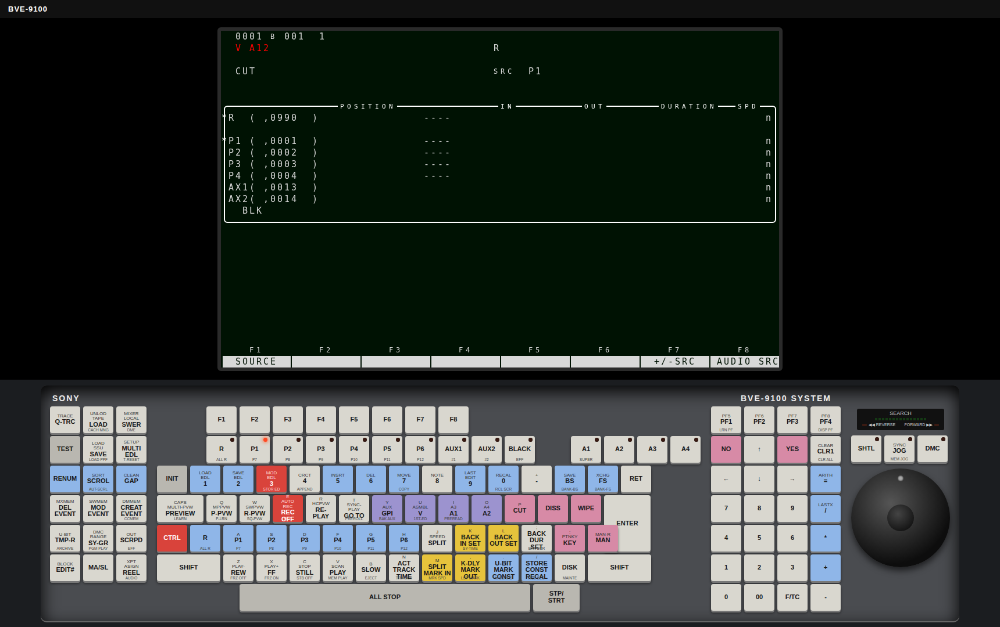

# BVE-9100 emulator

Runs the original software of the **Sony BVE-9100** editing controller in your browser, with an on-screen
Sony keyboard and virtual tape decks and switcher attached.



## Setup (once)

You need macOS or Linux, a C++ compiler and Python 3.

```sh
brew install lhasa cmake                 # macOS
sudo apt install lhasa cmake g++ unzip   # Linux (Debian/Ubuntu)
./tools/unpack_ref.sh          # unpacks the Sony installer disks from ref/ into work/
cmake -B build && cmake --build build -j
```

## Start

```sh
./run_ui.sh
```

Your browser opens <http://127.0.0.1:8090/>. The machine boots in fast-forward for about ten seconds and
then runs in real time on the edit page. Stop it with Ctrl-C in the terminal; the editor's memory (setup,
device assignment, EDL) is kept in `work/run/sram.bin` for next time. Delete that file to start from a
factory-fresh machine. Use `PORT=9000 ./run_ui.sh` to pick another port.

## First time: assign the decks

Four virtual VTRs are connected to ports A-D and a video switcher to port E. Tell the editor about them once:

1. Press **INIT**, then **F3** (ASSIGN).
2. Press **F7** to show the second menu page, then **F4** (DFLT ALL) and **YES**.
3. Press **RET** until you are back on the edit page.

The reel lines now show R on port A and P1-P3 on ports B-D, each with timecode and transport state. Every
virtual tape starts at 01:00:00:00.

## Using the keyboard

* Click the keys on the on-screen keyboard. **SHIFT** and **CTRL** arm the next key: the small top legend
  on a key is its SHIFT function, the bottom legend its CTRL function. Hover a key to see what it sends.
* Your computer keyboard works too: letters, digits and Space act like the same position on the Sony keyboard
  (for example A = P1, V = PLAY, Z = REW, X = FF, C = STILL, Space = ALL STOP). F1-F8 are F1-F8, F9-F12 are
  PF1-PF4, Esc is INIT, Enter is ENTER, Home is RET, Page Up / Page Down are YES / NO, Backspace and Tab are
  BS and FS. Shift+digit and Ctrl+key give the top and bottom legends (Ctrl+3 = STOR ED).
* The lamps on the keyboard follow the editor: the selected source (R, P1-P6, AUX, BLACK), the audio
  channels A1-A4 and the dial mode.
* The search dial: press **JOG**, **SHTL** or **DMC**, then drag the dial around (or scroll over it). In
  shuttle, the further you turn from where you started, the faster the deck winds; turn back to stop.

## Editing

* **Transport:** select a deck (R or P1-P6), then PLAY, STOP, STILL, FF, REW, SLOW, or the dial.
* **Go to a timecode:** select the deck, type the timecode on the number keys, press **SET IN**, then **GO TO**.
* **Mark an edit:** select a deck and press **SET IN** / **SET OUT** (or type a timecode first), choose CUT,
  DISS or WIPE, then **CTRL+3** (STOR ED) to store it in the EDL.
* **Preview** an edit with **PREVIEW**; record a single edit with **CTRL+REC**; run the whole EDL with
  **AUTO REC**. **ALL STOP** aborts.
* To recall an edit from the EDL, type its number and press **BS**.

The switcher answers the editor but does not switch any video yet.

## Driving the decks from outside

The emulator serves a small HTTP interface on the same port, so scripts or other programs can watch and
control the virtual devices:

```sh
curl http://127.0.0.1:8090/devices                               # state of every deck and the switcher
curl -X POST -d play  http://127.0.0.1:8090/devices/B            # put P1 (port B) in play
curl -X POST -d "cue 108000" http://127.0.0.1:8090/devices/B     # cue to frame 108000 (01:00:00:00)
curl -X POST -d +20   http://127.0.0.1:8090/dial                 # turn the search dial
```

## More

* `docs/development.md`: how the emulator works, command-line options and the project layout.
* `docs/hardware.md`, `docs/rs422-idc.md`, `docs/keyboard-codes.md`: reverse-engineered hardware and protocols.
